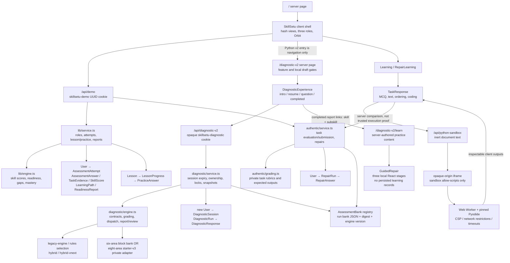
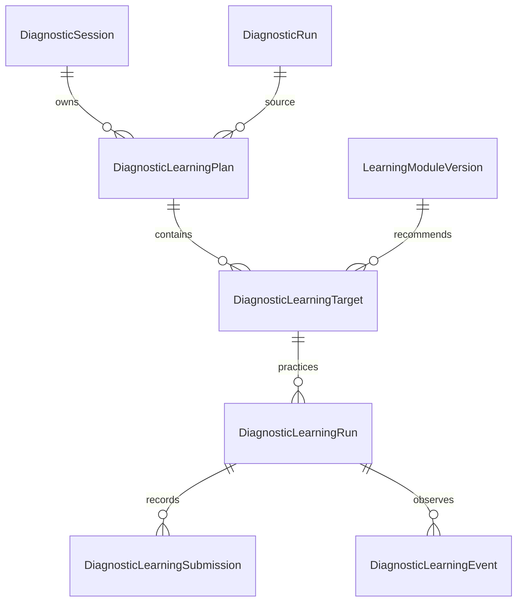

# SkillSetu V2: source-grounded interactive learning plan

Planning inspection: **3 November 2026**. Status: **proposal only; no application implementation or migration**.

## Findings and boundaries

SkillSetu already has the assessment, learning, repair, adaptive, execution and presentation building blocks. The next step is a small integration layer: diagnostic-owned learning persistence, reviewed content routing and reusable runner adapters. Rebuilding the workspace, adaptive engine, Python sandbox or Orbit would duplicate working systems.

The principal boundary is identity. `/api/demo` and `/api/diagnostic-v2` do not represent one student automatically. They issue different cookies and normally create different `User` rows. A V2 assessment is not a legacy baseline, even though both ultimately use the same Prisma schema. A content recommendation is not a score conversion.

This report inspects the present local source, including the previous uncommitted security repair. Local HEAD remains `7c91a18c4bb9d46d0561f90f1dd9624ca0fc7050` on `codex/security-dependency-patches`; its committed tree matches imported reference `c3c409fb0a819cbda6c89b68d0e13333badc0733`. The present manifest/lockfile additionally contain the local Next/eslint-config-next 16.4.1 and Zod 4.6.6 repair. Existing modifications to those manifests and the security/status documents are preserved. This plan makes no statement about deployed source or production database parity.

No running server, database contents, credential file or production data was inspected. No tests that write data, build/setup, migration, seed, dependency installation, push, PR or deployment was run for this planning task. Content counts below were calculated by importing pure authored modules, without importing services or connecting to a database. Only this new report is a deliverable change.

## 1. Actual architecture

The source is one Next.js App Router monolith, with two independent prototype session domains and a shared Prisma client configured by the process's `DATABASE_URL`. The same source can be launched against different stores; a common schema does not establish either common runtime storage or common identity.

Important absences: V2 completion does not call `completeAssessment`, create `SkillScore`, `LearningPath`, `LessonProgress` or `RepairRun`; the V2 learn page does not call either session resolver. Orbit is presentation only, not a tutor agent, learner model or reward persistence service.

### What existing documents no longer describe exactly

`docs/diagnostic-v2/SYSTEM_ARCHITECTURE.md` retains an older FEEDBACK phase. Current `DiagnosticExperience` has LOADING/INTRO/RESUME/QUESTION/COMPLETED and transitions directly after saving. Earlier security/blueprint documents describe a 36-item bank; the current default non-starter bank is the **60-item** block bank with six competencies. Eight-area new runs use `hybrid-4.1.0-draft.1`; older starter documentation describes v4.0. Existing snapshots intentionally preserve older content and engines. Those historical documents are evidence of prior states, not authority to rewrite current source.

## 2. Existing functionality inventory

| System | Present source behavior | Limit to preserve or address |
| --- | --- | --- |
| Three-role journey | Role selection, workspace, assessment, skill map, lessons, reassessment, readiness report and fictional cohort views | Active-role filtering prevents cross-role credit; no authenticated institutional tenancy |
| Legacy content | Data Analyst: 16 skills/16 lessons/64 practice items; Python: 17/17/68; Java: 18/18/72 | 51 micro-lessons and 204 practice items exist in authored content; Python workspace currently chooses deeper repairs |
| Authentic Python | Two baseline and three reassessment banks, each 68 tasks over 17 skills; stable starting variants and bank rotation | These are separate from adaptive V2; evaluation remains prototype evidence |
| Deep Python repair | 17 modules, six tasks each: guided, independent, harder, workplace, verification, transfer; interactive/structured modes | 102 repair tasks exist; not a comprehensive course for all V2 subskills |
| Ordinary lesson mastery | First answers, hints, retry, mode switch, restart; 3/4 correct first responses including final item | Does not alter assessed proficiency; hints are not durably tracked as assistance |
| Repair mastery | First-response scores, retries and run counter; at least 5/6 first responses at score ≥0.75 including final transfer | Current rule is practice attainment, not unaided independent mastery; evaluations/hints are not persisted |
| Adaptive V2 | Strict bounded answer contracts, item selection, assistance/uncertainty, drafts/resume, neutral saves, final report and complete question review | No durable learning/practice loop from its report |
| Six-area V2 | 60-item block/review bank; original six-area skill metadata; policy 18 minimum / 24 target / 30 maximum / 3 coverage | Existing legacy snapshots remain supported, not replaced by starter content |
| Eight-area preview | 360 questions, 120 families/subskills, 45 items per area; 216 MCQs, 135 integer inputs, nine floats; policy 24/24/30/3 | All 360 review entries remain PENDING and learnerEligible=false; local gate is not educator approval |
| Hybrid v4.1 | Balanced counts, intermediate start, repeated-evidence difficulty changes, unique families, seeded ties, tagged probes/counter-evidence, honest exhaustion | Preliminary heuristics, no IRT/calibration; prerequisite context is reported rather than a hard mastery gate |
| Reporting | Sealed V2 report, counts, uncertainty, prerequisites, subskill links, answer review with correct answers after completion; legacy before/after and A4 reports | V2 findings and legacy readiness are different measures, not interchangeable percentages |
| V2 learning starters | Eight broad starters plus a targeted binary-search lesson with O(log n), halving and comparison to linear search | Local-only stages; most subskills fall back to broad content; no stored practice or transfer result |
| Python execution | Existing `TaskResponse` runs a hidden opaque iframe/worker, pinned Pyodide 0.29.3 assets; timeout/cancel/recovery and bounded server payloads | Browser outputs can be forged; no server-side certification of execution |
| Presentation | Shared Learning Studio theme, original Orbit SVG, reduced motion, mobile drawer/focus behavior and reusable controls | No new design framework or mascot is needed |

The six-area findings use task diversity and repeated independent evidence. The eight-area v4.1 engine uses at least three independent families/two subskills plus applied evidence for stronger conclusions. Assistance and explicit unsure cannot establish a misconception. Competency prerequisites contribute report ordering/context; do not describe the current v4.1 selector as a prerequisite-unlocking course engine.

## 3. Exact reuse points

| Existing component/function | Reuse as-is or through a small adapter | Integration change needed later |
| --- | --- | --- |
| `SkillSetu` in `src/components/skillsetu.tsx:48` | Keep role shell, hash views, navigation, cohort/report paths and original Orbit | Add explicit V2 learning entry/state, not fabricated legacy attempts or fake `DemoState` |
| `Learning` and private `LessonRunner` (`learning.tsx:16`, `:164`) | Four-stage lesson rendering, mode switch, concepts, MCQs, feedback, mastery display | Extract/export runner with a small learning-specific view contract if shared; retain legacy adapter/gates |
| `RepairLearning` (`repair-learning.tsx:9`) | Six-task roadmap, mode switch, transfer and retry UI, existing plan presentation | Separate runner presentation from legacy `DemoState`, completed baseline and score dependencies; reuse module view via a V2-owned adapter |
| `GuidedRepair` (`guided-repair.tsx:4`) | Prediction → example → reasoning scaffold and binary-search teaching copy | Add controlled state/callbacks only when persisting; free text currently has no rubric and must not imply a graded prediction |
| `TaskResponse` (`task-response.tsx:7`) | Existing decision/text/ordering/coding controls, local drafts and iframe/worker plumbing | Supply V2-authorized evaluate/submit callbacks and session/module/run-scoped keys; do not call `/api/demo` implicitly |
| `DiagnosticExperience`/`QuestionControls` (`diagnostic-experience.tsx:50`, `:673`) | Keep assessment runner, debounce, validation, final-only correctness and report links | Link to an owned learning plan; never mix practice feedback into assessment state |
| `DiagnosticManipulation`, `CodeBlockComposer`, `DiagnosticOption` | Original state cards, boundary/error localization, code blanks, accessible whitespace rendering | Reuse controls with controlled persisted state; graded repair sequencing can reuse ordering controls without copying answer keys into the client |
| `DiagnosticQuestionReview`, `DiagnosticScore` | Owned sealed report review and transparent correct/total counts | Preserve archived solution lookup and original outcomes; add practice review as a separate domain |
| `LearningCompanion` (`learning-companion.tsx:4`) | Same Orbit artwork, moods, unique SVG IDs and reduced motion | Contextual copy only; no fabricated mastery, streak or psychological inference |
| `publicTask`, `publicRepair`, `gradeTask` | Reuse private rubric/public projection contracts for approved learning modules | New authorization wrapper and immutable module snapshot; existing browser-output trust limitation remains |
| `planGaps` / `repairPlan` | Reuse only where inputs really are legacy skill scores and mapped skill requirements | Do not feed categorical V2 findings as invented numeric scores; use V2 report learningOrder and reviewed routing |
| `diagnostic/service.ts` transaction patterns | Owned row locking, strict retries, immutable snapshot/digest and report sealing patterns | New learning tables/services, not a call to `respond` to record practice |
| `ui.tsx`, `studio.css`, existing CSS modules | Meter, Empty, Steps, cards, buttons, layout and focus/motion conventions | Composition only; keep print rules and current three-role screens |

Avoid both shortcuts: (a) removing legacy baseline checks to make V2 links work; (b) populating a synthetic `DemoState.attempts` entry from a V2 report. Both would confuse authorization and evidence provenance.

## 4. Legacy versus V2 identity

| Property | `/api/demo` | `/api/diagnostic-v2` |
| --- | --- | --- |
| Cookie | `skillsetu-demo` contains `User.id` UUID | `skillsetu-diagnostic` contains 32 random bytes encoded as a 43-character bearer token |
| Server identity | Validate UUID and existing User | SHA-256 lookup in DiagnosticSession plus expiry; session references its own User |
| New entry | `createStudent(name, role)`; existing valid cookie is reused | `enter(name)` creates new Python User and DiagnosticSession; existing valid diagnostic cookie is reused |
| Lifetime | Cookie 30 days; no server session expiry/revocation model here | Cookie and server session expiry 30 days |
| Cookie flags | HttpOnly, SameSite=Lax, Secure on HTTPS, path `/` | HttpOnly, SameSite=Strict, Secure on HTTPS, path `/` |
| Authorization | Owned user attempts, active role and own completed role baseline for lessons/repair | Owned session/run, bank/engine snapshot and status |
| Reset/leave | Deletes demo cookie; does not delete learner records | Deletes diagnostic cookie; does not delete learner records |
| Reassessment | Same demo user and role, own legacy baseline, bank variants | Same diagnostic session, fresh evidence; independent or disclosed prior-informed routing |

Example: a browser enters demo as **A** then V2 as **B**, even if both names are “Student.” Completing B's diagnostic must never unlock A's repair, copy A's mastery into B, copy B's findings into A's `SkillScore`, or change A's selected role. Names, same browser, cookie coexistence, URL query values and knowledge of a UUID are not account-linking consent or proof.

The current V2 CTA is a Next Link/router navigation only. It does not pass an authenticated handoff or establish shared ownership. The `DiagnosticSession.userId` relation added by the second diagnostic migration is an owner relation, not a bridge to whatever user the demo cookie names.

**Default design:** keep the two domains separate. New V2 learning resolves only `skillsetu-diagnostic`, and its records belong to that session. Do not set/change `skillsetu-demo`, reparent records, accept client-supplied user/session IDs, or fall back to the demo cookie when a diagnostic cookie is missing/expired. Losing a cookie must not silently recover another person's records.

If a future verified-account system is introduced, design linking as a separate explicit, auditable process requiring proof/control of each session and consent. Linking account access is not permission to regrade, merge proficiency or transfer practice mastery. No link or automatic historical backfill is proposed in this increment.

## 5. Competencies, legacy skills and learning targets

There are three distinct identifiers: a bank-scoped competency ID; a real `SkillNode.id` such as `py-functions`; and a content-route key such as `starter-functions8`. They must not be substituted for one another.

### Existing six-area metadata

`python-bank.ts` defines these mappings, inherited by reviewed/block forms:

| Six-area competency | skillIds / moduleSkillId |
| --- | --- |
| values | py-fundamentals |
| collections | py-structures |
| functions | py-functions |
| errors | py-exceptions |
| validation | py-validation |
| testing | py-testing |

Even these explicit metadata links do **not** create legacy scores or authorize `/api/demo` practice. The V2 learn page uses the module key to find authored explanatory content.

### Current eight-area adapter and proposed reuse mapping

All eight `skillIds` arrays are **empty** in `starter-v3/bank.ts:81`. The `starter-*` keys are not database skills. The table's last column is a **proposed content crosswalk**, requiring family/subskill-level review; it is not implemented equivalence or a score conversion.

| V2 ID / name | Current module route key | Existing content candidates; limits |
| --- | --- | --- |
| fundamentals — Python Fundamentals | starter-fundamentals | py-fundamentals; py-comprehensions for comprehensions; py-functions for closure/scope cases. Rational/float, generator and advanced scope coverage needs review |
| collections8 — Collections & Mutation | starter-collections8 | py-structures, py-comprehensions; py-functions for mutable defaults. Counter/iterator/nested-copy details are not automatically covered |
| functions8 — Functions & Recursion | starter-functions8 | py-functions and selected py-reasoning. Recursion, memoization, decorators, generator/descriptor semantics need dedicated checks/content |
| objects — Object-Oriented Python | starter-objects | py-oop, selected py-quality. MRO, dataclasses, slots and descriptors require explicit coverage beyond a general OOP module |
| dsa — DSA Using Python | starter-dsa | py-reasoning, selected py-structures/comprehensions; existing targeted binary-search starter. Full DP/heaps/graphs/monotonic-stack coverage is absent from a reviewed V2 learning map |
| debugging — Debugging & Exceptions | starter-debugging | py-exceptions, py-debugging; py-validation/files for boundary/cleanup contexts. Map particular exception behaviors individually |
| testing8 — Testing & Validation | starter-testing8 | py-testing, py-validation, py-debugging. Property-based/metamorphic, mock and floating-point topics require specific lesson checks |
| practical — Practical Python Coding | starter-practical | py-files, py-modules, py-quality, py-validation; selected py-functions/comprehensions/reasoning by task. Do not infer complete HTTP/SQL coverage from this broad label |

The 17 existing Python skill IDs are: `py-fundamentals`, `py-functions`, `py-structures`, `py-comprehensions`, `py-modules`, `py-oop`, `py-exceptions`, `py-files`, `py-debugging`, `py-testing`, `py-http`, `py-sql`, `py-quality`, `py-reasoning`, `py-clarification`, `py-communication`, `py-validation`. V2 does not establish evidence across all 17, especially the workplace communication/requirements and integration domains. Do not claim a full role-readiness result from eight broad categories.

Use a versioned, separate crosswalk keyed by bank/content version + competency + family/subskill identity. It should record target module version, applicable step/subskill, learning objective, coverage (`exact`, `partial`, `missing`), rationale and review state. Family IDs are available; subskill strings alone are not stable IDs. Several competencies need several modules and several subskills share modules. Unmapped items stay explicitly unmapped. Do not edit published bank metadata merely to insert this crosswalk.

For “Insufficient evidence,” recommend exploration or further assessment, not a diagnosed weakness. For a preliminary repeated hypothesis, select a matching concept/boundary task without presenting the hypothesis as psychometric fact. Preserve the existing binary-search specialization: O(log n), sorted/indexed assumptions, halving and linear-vs-binary comparison; never substitute graph content for that specific misconception.

## 6. Gaps preventing complete interactive learning

| Priority | Source-supported gap | Narrow solution |
| --- | --- | --- |
| P0 integration invariant | Demo and V2 ownership are unrelated by default | Explicit diagnostic principal; session-owned learning service with no cookie fallback or transfer |
| P1 | V2 report has content links, not a saved learning plan or learning authorization | Create an owned plan from an owned completed run; preserve source report and mapping version |
| P1 | Existing lesson/repair API requires a completed legacy baseline; V2 creates DiagnosticRun, not AssessmentAttempt | Add a V2-only wrapper using its own authorization; leave legacy checks intact |
| P1 | 120 family/subskill targets route largely to eight broad starters; all 360 questions await approval | Build reviewed coverage matrix, reuse matching repair steps, author only missing subskills under new content versions |
| P1 | GuidedRepair stage/prediction/choice are React state only; refresh loses them; transfer is a prose prompt | Controlled runner plus durable drafts/responses; actual reviewed transfer item and honest completion semantics |
| P1 credibility | GuidedRepair always treats options[0] as correct; prediction text is only checked for nonempty input | Explicit private answer contract/public projection for persisted checks; predictions can remain ungraded reflection |
| P1 credibility | Existing hint/evaluate endpoints do not persist assistance or evaluation exposure | New learning event/attempt assistance tracking; first submission alone does not prove independent work |
| P1 integrity | Ordinary practice lacks durable request idempotency and a locked first-answer invariant; repair retry appends rows without transport keys | Unique request IDs, row locks and first-response uniqueness for new tables; do not rewrite historical rows |
| P2 | Learning/repair runners depend on DemoState and legacy latest scores | Extract view-only runner contracts and provide separate demo/V2 adapters |
| P2 | DiagnosticManipulation initializes stop=3, line=null and notes={} without restored draft input | Controlled manipulations with one source of truth and explicit scratch-state persistence policy |
| P2 | Existing localStorage coding drafts are browser-only; new sessions/devices do not recover them | Bounded server drafts for new V2 learning runs; namespace local fallback by owner/module/version/run |
| P2 | Generic restart uses the same worked example/check; existing modules are fixed finite content | Label retries/practice honestly; new-run transfer variants with exposure tracking, no automatic proficiency credit |
| Release | No real account recovery, distributed quotas, institutional ACLs, measured concurrency or complete accessibility validation | Keep staged/local feature gate; separate release hardening and human validation |

The manipulation refresh issues are not inferred solely from old screenshots: the present component still takes only `question` and `onDraft`, initializes its own stop/line/notes state, and receives no restored draft prop. This report does not modify it or assert a new browser reproduction. State cards are descriptive prompts, not a Python state simulator. GuidedRepair “Try another case” resets stage/choice while retaining prediction and usually reuses the same case; it is not an unseen exercise generator.

## 7. Existing data-model constraints

| Model/constraint | Consequence for this integration |
| --- | --- |
| User has selectedRoleId String and relationships to both subsystems | Shared entity type is not verified account identity; no email/login/consent/linking model |
| DiagnosticSession: unique tokenHash, user FK, expiresAt | Good scoped owner; no durable account recovery/revocation workflow beyond expiry/cookie loss |
| DiagnosticRun: session FK, bankSnapshot/digest, engineVersion, draft/report text | Preserve immutable assessment evidence; no FK to AssessmentAttempt, SkillScore or LearningPath; no learning state |
| DiagnosticResponse: unique run/question and run/position | Good sequenced/idempotent scored evidence; no per-step learning attempts; only correct/assisted plus payload, so unsure is reconstructed from payload |
| Diagnostic competency/item IDs are inside snapshots, not relational catalogs | Mapping must be bank-scoped/versioned; cannot point arbitrary competency IDs at SkillNode FKs |
| DiagnosticRun.bankId and roleId are Strings without those relational FKs | Application verifies content/ownership; additive tables need explicit consistency validation rather than assuming FK coverage |
| AssessmentAttempt links User + Assessment, optional bank, versions and skillSnapshot | Legacy proficiency belongs here; do not manufacture an attempt to satisfy lesson gates |
| SkillScore primary key attemptId/skillId; LearningPath.attemptId unique | Numeric legacy assessment scores and legacy plan cannot faithfully hold V2 categorical findings |
| Lesson.skillId unique; content JSON stored as String | One legacy module per skill; no independent immutable lesson-version catalog or subskill map |
| LessonProgress unique userId/lessonId, run counter, mode/status | One mutable aggregate per lesson; answers retain run numbers, but no per-run content snapshot and only current-run view is returned |
| PracticeAnswer has selected/correct/first but no request key, hint flag or item FK | Cannot directly represent all multimodal V2 learning responses or reliable first-unaided evidence |
| RepairRun unique userId/skillId, moduleVersion/contentSnapshot, mutable run counter | Snapshot reuse is valuable; a new module version cannot coexist as another progress row for the same user/skill. Restart retains the old snapshot |
| RepairAnswer stores payload/score/first/run but no request key or task FK | Flexible multimodal storage; application enforces task/order, retry semantics need stronger request identity |
| Status/mode/version/payload fields largely String | Enforce strict schemas/state transitions and versioned decoding; no new assumptions that old data meets future enums |
| Cascades exist from several attempt/progress parents | Never repurpose, delete, reparent or reset historical rows to implement a new course |

Historical qualifications: versioned Python attempts pin bank and skill content and V2 pins per-run banks/reports. Ordinary legacy questions/lessons remain relational/live content; regular lesson progress has no content snapshot. Therefore “everything is already immutable” would overstate the schema. Preserve old behavior and add snapshot guarantees for new learning runs without backfilling guessed content.

Assessment/repair services use transactions but do not all have identical safeguards. V2's owned lock includes sessionId. Legacy assessment lock queries precede owned lookup; ordinary practice does not lock the progress row. These are reuse patterns requiring a deliberate new authorization boundary, not a reason to broaden old endpoints indiscriminately.

## 8. Safe additive persistence proposal

**Proposed, not generated/applied.** Introduce a diagnostic-owned learning domain alongside existing tables. Reuse content and grading/rendering functions; do not reuse legacy progress rows as a shortcut. Stable assessed proficiency stays in original assessment models. Practice state lives only in new learning models.

### Proposed records

| New record | Essential fields and constraints |
| --- | --- |
| LearningModuleVersion | Immutable ID, source module ID/version, roleId, schemaVersion, private contentSnapshot/digest, evaluatorVersion, review/release state and provenance. Unique source ID/version. Existing approved-for-current-scope repair snapshots can be adapted without altering their source. Version any changed tasks/rubrics |
| DiagnosticLearningPlan | id, diagnosticSessionId, sourceRunId, roleId, mappingVersion, reportDigest, immutable recommendation snapshot/digest, createdAt. Unique sourceRunId/mappingVersion. Require owned completed source run; same session/role; no browser-supplied scores |
| DiagnosticLearningTarget | id, planId, position, moduleVersionId, bank-scoped competency/family/subskill references, learning objective, reason and coverage state; unique plan/position. Missing coverage is an explicit resource gap, not a fake completed module |
| DiagnosticLearningRun | id, targetId, ordinal, mode, status, currentStep/task, bounded draft, draftRevision, evaluator/mastery policy version, timestamps. Unique target/ordinal. Derive owner through target→plan→session; never through a client userId. New row for each restart, not an overwritten run counter |
| DiagnosticLearningSubmission | id, learningRunId, taskId, per-task attempt number, idempotencyKey, payloadHash, bounded payload, outcome/score, assisted/exposure snapshot, first flag, private evaluation metadata and timestamp. Unique run/idempotencyKey and run/task/attempt. Partial unique index for one first submission per run/task |
| DiagnosticLearningEvent | append-only bounded event: runId, sequence, type (hint/evaluate/concept-reveal/etc.), task/step, idempotencyKey, timestamp and minimal metadata. Unique run/sequence and run/idempotencyKey. No bearer tokens or unnecessary raw learner content in telemetry |

The versioned crosswalk can start as a reviewed private source manifest and be snapshotted into each plan; a database authoring/CMS subsystem is not necessary. Public DTOs omit keys, expected outputs, rubric internals and registry snapshots. Proposed column names/types/indexes must be finalized against Prisma 6.19 and a disposable migration rehearsal later; this table is not migration SQL.

### Authorization and transaction contract

1. A separate V2 learning service resolves only the opaque diagnostic cookie and checks expiry. No accept-any-cookie resolver and no userId/sessionId input. Public teaching content may remain readable; persisted state requires that identity.
2. Plan creation validates owned completed source run and its snapshot/digest; derive targets from the sealed report and reviewed crosswalk. Store the plan, do not mutate the report's learningOrder, responses or grades. Do not write SkillScore/LearningPath/RepairRun/LessonProgress.
3. Validate target/run/module access through the full owner chain on every read/write. For redundant owner/source relations, use composite FK/unique constraints where practical and transactional equality checks where Prisma cannot express them. A FK alone does not guarantee two referenced rows have the same owner.
4. Lock owned run before changing step, assistance or submissions. Validate exactly one allowed response modality against the pinned task. Exact key/hash replay returns the stored result, changed replay is 409; different transport keys cannot create two first responses. Changed submitted evidence is a new explicit learning retry, never an overwrite.
5. Server grades the pinned authored task; browser Pyodide remains isolated and its outputs remain inspectable/forgeable. Do not run learner code in the service. Preserve request-size bounds, output bounds, origin checks, timeouts, no-store headers and key-free projections.
6. Hint/evaluation/concept exposure and final submission share ordered transaction semantics. At the first committed submission, snapshot prior relevant exposure. Conservative labels distinguish guided success, first submitted success and independent transfer. Do not retrospectively change an old first-response grade. Exact exposure-to-mastery policy is versioned and reviewed.
7. Debounced drafts carry revision or expected revision. Reject stale writes so delayed requests/other tabs cannot overwrite newer state; server is authoritative. Keep raw display whitespace and code intact. Separate scratch UI state from submitted payload and explicit assistance.
8. On completion, seal a practice summary with module/evaluator/mastery-policy versions and counts. No assessment score write. A later V2 reassessment creates a fresh DiagnosticRun under its own policy and may improve, decline or remain uncertain. Practice cannot seed correct answers or reduce mandatory coverage.
9. Preserve session expiry behavior. No automatic renewal/rebinding to a different demo identity. Future account recovery is a separate authenticated design.

Suggested API surface: keep public `/diagnostic-v2/learn` content routing, add an explicit authenticated `/api/diagnostic-v2/learning` controller for plan/read/start/draft/hint/evaluate/submit/retry. Validate at least as strictly as the current diagnostic route. A persisted deep link carries owned source run/target identity; current `skill`/`subskill` query strings alone never authorize records or create a claimed assessment result.

### Migration, compatibility and rollback

Only add new tables, indexes and any supporting non-destructive unique/composite keys after isolated rehearsal. Leave every applied migration untouched. No renaming of old IDs, backfill, record transfer, regrading or deletion is needed. Do not run `npm run setup` or unguarded build against learner storage during implementation: setup/build may invoke migration and seed. Explicit TEST_DATABASE_URL and matching runtime DATABASE_URL must point to a newly disposable store.

Rollout is opt-in development/staging. Public draft questions remain disabled; local loopback gating is not a substitute for a future approved staging allowlist. Roll back by disabling new-learning routes/flags and restoring the old content links, preserving additive tables and all records. Keep decoders for any version already used by a learning run. Do not roll back by dropping tables or resetting old progress.

## 9. Incremental implementation plan

| Stage | Small deliverable | Acceptance gate |
| --- | --- | --- |
| 0: preserve and specify | Capture source/schema/bank fingerprints; isolated test harness; typed demo vs diagnostic principals and source ownership invariants | Existing tests pass on disposable storage; simultaneous cookies A/B explicitly remain separate |
| 1: content crosswalk | Inventory all 120 families, tag exact/partial/missing reuse, stable versioned routing; preserve eight competency IDs | Educator review for candidate routing; no scores or records changed; unknown routes fail honestly |
| 2: runner extraction | Extract reusable lesson/repair presentation from DemoState; keep current adapters and Orbit/theme/sandbox | Legacy journey/screenshots unchanged; V2 can render a module without fabricated legacy score/baseline |
| 3: additive persistence | New learning catalog/plan/target/run/submission/events and owned service; migration only on disposable DB | Ownership, idempotency, concurrency, snapshot and rollback tests pass; no existing rows changed |
| 4: one vertical slice | Target binary-search complexity from a completed owned V2 report; reuse GuidedRepair scaffolding/TaskResponse; persist resume and actual transfer check | Student finishes/resumes one relevant lesson; practice attainment displayed separately; source report byte-identical |
| 5: reuse broader modules | Connect reviewed matched portions of the 17 existing repairs; use micro-lessons where objectives truly match | Coverage shown per subskill, no entire-competency mastery from a partial module; all-role legacy suite remains green |
| 6: fill content gaps | Original reviewed modules for missing recursion/OOP/DSA/testing/practical objectives, not a replacement diagnostic bank | Valid keys/distractors, accessibility labels, hints, examples and unseen transfer tasks; new immutable versions |
| 7: assess again | Link to existing independent/prior-informed V2 new-run flows with explicit provenance | Assessment uses only new scored evidence; no practice mastery imported; saved reports remain readable |
| 8: release readiness | Abuse controls, account/recovery policy, retention and backup rehearsal, accessibility/device review, staged load measurement | Explicit release approval and reviewed content manifest; no hiring guarantees or unsupported capacity claim |

Within an implementation turn, continue through authorized work without milestone permission prompts. This current request authorizes **planning only**: none of these stages is started by this report. A future implementation should start with the narrow vertical slice rather than authoring 120 new courses or inventing a new adaptive engine.

## 10. Required regression tests

### Keep and extend existing tests

| Existing test area | Preserve |
| --- | --- |
| `tests/roles-service.test.ts`, `tests/service.test.ts`, `tests/tracks.test.ts`, `tests/engine.test.ts` | Three-role filtering, baseline gates, true reassessment decline, lesson ordering/mastery and no key leakage |
| `tests/authentic-service.test.ts`, `tests/authentic.test.ts` | Bank immutability/variants, repair first-response history, mode/resume and unchanged readiness |
| `tests/diagnostic-service.test.ts`, `diagnostic-hybrid-service.test.ts`, `diagnostic-starter-service.test.ts` | Opaque sessions, ownership, duplicate saves, hints/drafts, start/restart, version preservation, sealed reports |
| `tests/diagnostic-engine.test.ts`, `diagnostic-hybrid-vnext.test.ts`, `diagnostic-starter.test.ts`, `diagnostic-blocks.test.ts` | Independent/struggling/mixed/assisted/unsure selection, bounded coverage, family uniqueness, exhaustion and grading contracts |
| `tests/diagnostic-review.test.ts`, `diagnostic-presentation.test.ts`, `diagnostic-repair.test.ts` | Archived correct options, whitespace rendering, numeric validation, recommendation relevance |
| `tests/migrations.test.ts`, `build-safety.test.ts`, `diagnostic-runtime.test.ts` | Repeatable additive setup on isolated storage; historical preservation; no hosted build writes; safe diagnostic store startup |
| `e2e/journey`, `developer-tracks`, `authentic-python`, `mobile-authentic` | End-to-end all-role assessment→learning→reassessment→print, no cross-role credit |
| `e2e/diagnostic-*`, `workspace-python-v2`, `studio-interface` | Final-only feedback, review, immediate transition/retry, old snapshots, six/eight UI, mobile/focus/reduced motion and shared design |
| `e2e/sandbox`, `code-banks`, `authentic-security` | All authored coding contracts in browser, timeout/recovery, no file/network/environment access, hostile payload rejection |

### New tests required before integration is accepted

| Proposed suite | Cases and observable assertions |
| --- | --- |
| Session isolation, service + API | Demo A and diagnostic B in the same browser, identical names, both cookies; V2 learning only writes B-scoped tables. Clearing/expiring B never falls back to A. Demo-only cookie, guessed UUID/session ID, foreign run/target and cross-role module all fail. Selected demo role and A's history remain unchanged |
| Identity non-transfer | V2 B completion does not satisfy A's legacy baseline or create AssessmentAttempt/SkillScore/LearningPath. A's existing mastery does not appear for B. V2 learning never sets demo cookie; switching demo roles never changes B's records |
| Crosswalk/content contracts | Every approved target has versioned exact/partial coverage; all 120 families accounted for as mapped/partial/missing. Unknown or unreviewed mapping gives explicit unsupported state. Complexity routes to halving/O(log n); no graph substitution. No score conversion, substring guessing or fictitious mastery for unmapped skills |
| Snapshot/historical integrity | Pin source report, module content and evaluator. Version update during a lesson leaves old run unchanged; new run uses new version. Hash/copy old reports, bank snapshots, attempts, practice/repair rows before and after; assert byte/value equality, not just row existence. Old payload decoders and report bookmarks still work |
| Learning state machine | Prediction can be ungraded; check/transfer have actual private contracts. No skip-forward first submissions; review/retry allowed explicitly. Complete needs required tasks/transfer. Restart creates a new run, mode change preserves state, original submissions remain append-only |
| Assistance/attainment separation | Hints, evaluation and revealed examples recorded before submission; guided/assisted successes never labeled unaided transfer. Failed first response plus later success preserves both. Completion/retry cannot update either legacy SkillScore or V2 report proficiency. Reassessment may stay flat or decline |
| Idempotency/concurrency | Concurrent exact submit returns one first response; changed same-key payload is 409; different keys cannot create competing first responses. Race hint vs submit and restart vs submit. Active-run start serializes. Define deterministic exposure semantics and check rollback atomicity |
| Drafts/network recovery | Refresh every step/control, localStorage absent/corrupt/quota full, aborted request before commit and lost response after commit. Reconnect reads authoritative committed state. Stale revisions and cross-tab writes rejected; retry never duplicates submission or consumes assessment question |
| Manipulation controls | Restored boundary slider/number/answer agree; restored error-line radio agrees; state-card notes follow declared persistence policy. Keyboard/touch alternatives and reset stay synchronized; scratch edits never silently become submitted grades |
| API/security | Required Origin/Host/content type, strict streaming size bound, malformed/oversized/nested payloads, illegal IDs, revoked/expired ownership, draft/content gate. Active learning/assessment projections omit keys/expected values/private snapshots. Completed owned review teaches only intended content. No learner code execution in server tests |
| Sandbox + grading | Preserve opaque origin, worker timeout/terminate, pinned asset CSP/network bounds, request-source validation and output limits. Retain explicit forged-browser-output limitation; test API grading contract without claiming authenticated execution |
| UI/accessibility | 1440/1024/390/320 widths, keyboard-only, focus after step/error, accessible status/validation, reduced motion, code whitespace, retained drafts without horizontal overflow; manual screen-reader and real device follow-up |
| Additive migration | New empty disposable DB plus a populated synthetic old schema; apply only new migrations and compare all old data/snapshots. Constraints reject invalid ownership/task versions, repeated first flags and duplicate request keys. Disable feature and verify legacy app runs with new tables retained |

### Verification procedure for a later implementation

Use separate ignored TEST_DATABASE_URL and an explicitly matching runtime DATABASE_URL on a disposable cluster. Vitest maps DATABASE_URL from TEST_DATABASE_URL but has a localhost fallback; tests invoke migrate/seed, so never run them blindly. Playwright can reuse an existing server: use isolated QA ports and fail if the server/database provenance is not the intended one. Do not point it at the user's saved local diagnostic store just because that store is on localhost. Preserve the inherited proxy/CA setup.

Run lint, typecheck, full unit/integration, guarded production build, then relevant Chromium journeys and newly added identity/persistence suites. Inspect desktop/mobile and printed reports. Re-run the exact production audit filter **and report the full/optional audit scopes**; the preceding local security report records remaining optional Prisma and development-tooling findings. No new runtime dependency is necessary for the first vertical slice.

No tests were executed in this planning task; earlier passing results belong to `docs/security-dependency-review/README.md` and are not claimed as new verification. Unknowns include full educator coverage decisions, actual runtime/production parity, account recovery and measured load. These do not justify guessing identity equivalence or changing current records.

## Source evidence and documents inspected

Primary code anchors (repository-relative line numbers at inspection):

| Concern | Source |
| --- | --- |
| Shell/API dispatch and legacy runner selection | `src/components/skillsetu.tsx:48`, `:157`, `:209`, `:245`, `:782`, `:812` |
| Ordinary lesson and repair presentation | `src/components/learning.tsx:16`, `:164`; `src/components/repair-learning.tsx:9`; `src/components/guided-repair.tsx:4` |
| Diagnostic phases, report links and autosave | `src/components/diagnostic-experience.tsx:50`, `:561`, `:673`; `src/components/diagnostic-manipulation.tsx:5` |
| Demo UUID cookie/action dispatch | `src/app/api/demo/route.ts:106`, `:151` |
| Diagnostic strict transport/session dispatch | `src/app/api/diagnostic-v2/route.ts:80` |
| New diagnostic identity, pinned bank, owned transactions | `src/lib/diagnostic/service.ts:27`, `:50`, `:120`, `:215`, `:225`, `:280` |
| Legacy role state/assessment/practice gates | `src/lib/service.ts:46`, `:221`, `:347`, `:459`, `:471`, `:490` |
| Authentic repair eligibility and mastery writes | `src/lib/authentic/service.ts:174`, `:213` |
| Grading/projections/engine compatibility | `src/lib/diagnostic/engine.ts:134`, `:216`, `:299`, `:424`; `src/lib/diagnostic/hybrid-vnext.ts`; `src/lib/diagnostic/report-review.ts` |
| Competencies, draft gate and starter routing | `src/lib/diagnostic/python-bank.ts:2`; `src/lib/diagnostic/starter-v3/bank.ts:81`, `:139`; `src/lib/diagnostic/starter-v3/lessons.ts:28`, `:37` |
| Module selection/content versions | `src/lib/authentic/python-banks.ts:480`, `:481`; `src/lib/tracks/index.ts`; `src/lib/tracks/authoring.ts`; `src/lib/tracks/python-topics.ts` |
| Execution and rubric trust boundary | `src/components/task-response.tsx`; `src/lib/authentic/grading.ts`; `src/lib/authentic/sandbox-document.ts`; `src/app/api/python-sandbox/route.ts` |
| Current tables and owner boundaries | `prisma/schema.prisma`, especially `:161`, `:259`, `:286`, `:295`; `src/lib/db.ts` |

Also inspected: AGENTS.md; package/test/CI configuration; `docs/AUTHENTIC_READINESS_SPEC.md`; `docs/ARCHITECTURE.md`; diagnostic SYSTEM_ARCHITECTURE, SECURITY_AND_SCALABILITY and QUESTION_BANK_BLUEPRINT; starter-v3 README, adapter/source metadata, clarifications, import and QUALITY_REVIEW manifest; hybrid-v41 README/source; audit-repair/interaction-audit findings; audit-fixes content/presentation notes; current security review and pending decisions. The review manifest has **360 pending / zero independently approved / zero learner-eligible** entries. Engineering option rendering and key consistency checks are not educator signoff.

This report is the stopping point. No proposed model, API, adapter, content mapping or identity link has been implemented.
