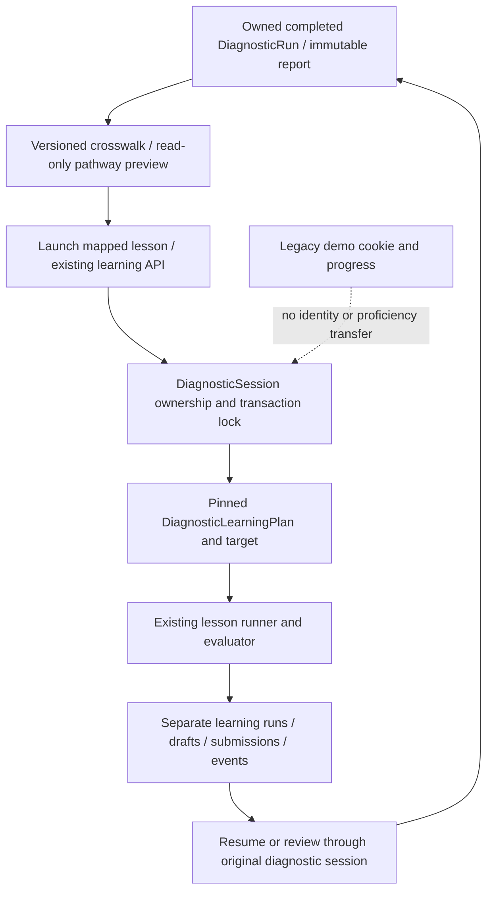

# Diagnostic V2 → Interactive Learning — Phase 4

Implemented locally on `codex/diagnostic-learning-pathway`, 3 November 2026. This extends the Phase 2 service/models and Phase 3 lesson. It does not introduce another database, learning service, assessment engine or account-linking system.

Local preview: **http://127.0.0.1:3007/diagnostic-v2**. Complete a synthetic diagnostic, then use its report's pathway panel. The isolated preview has its own synthetic history; existing learner records from other local stores have not been copied into it. Original report bookmarks still require their original diagnostic session and database. The prior development server on port 3002 is left intact.

## Exact integration path

1. Open a completed owned report at `/diagnostic-v2?run=<diagnostic-run-id>` using its original `skillsetu-diagnostic` browser cookie. The report's saved JSON and assessment evidence are read unchanged.
2. The new **Your personalized learning pathway** panel calls `GET /api/diagnostic-v2/learning?source=<diagnostic-run-id>`. The existing learning API validates the diagnostic session and source ownership, completion, Python role, bank digest and local draft gates. GET creates no plan or progress.
3. Recommendations follow `Report.learningOrder`, followed by the remaining findings explicitly labeled optional consolidation. The versioned crosswalk uses the competency ID, its pinned `Competency.moduleSkillId`, the matching finding skill ID and exact `nextSubskill`; it never guesses a match from a name or substring. The panel explains the report reason, proposed focus, existing Python skill/prerequisites, instructional introduction and limited lesson coverage.
4. A mapped **Launch interactive lesson** link opens `/diagnostic-v2/learn/variables?source=<diagnostic-run-id>&competency=<competency-id>`. The existing runner calls `POST /api/diagnostic-v2/learning` with `{action: "start", lessonId: "python-variables-references", sourceRunId, competencyId}`. No client-supplied owner, score, target, solution or mapping is accepted.
5. Under the existing diagnostic-session transaction lock, the service pins a `DiagnosticLearningPlan` with kind `diagnostic-pathway`, source run ID, report SHA-256 digest, mapping version and recommendation snapshot/digest. A `DiagnosticLearningTarget` pins the selected module version and partial-coverage explanation. The module content snapshot and evaluator remain versioned and immutable.
6. The service resumes the latest run for that **same validated session and exact module version**, whether entered independently or from another report. A report target can therefore record a recommendation while an existing standalone target continues to own the resumed run. This is an explicit same-session continuation, not copied or transferred records. New practice ordinals are monotonic across those entry points, preventing a new report from resetting fresh mastery forms.
7. Existing `draft`, `visit`, `hint`, `submit` and guided-sandbox actions save to the same learning tables. The return link opens the exact source report. The panel shows saved step counts and changes its action to **Resume** or **Review interactive lesson**. Archived owned learning runs remain available through the existing `?run=<learning-run-id>` API.

## Explicit content coverage

Mapping version: **`diagnostic-learning-1-draft.1`** in `src/lib/learning-studio/pathway.ts`. Lesson pinned to **`python-variables-references@1.0.0-draft.1`**.

| Competency | Exact subskill | Interactive coverage |
| --- | --- | --- |
| Six-area `collections` / `py-structures` | aliasing | Aliasing, rebinding and flat-list mutation |
| Eight-area `collections8` / `starter-collections8` | Aliasing and mutation | Aliasing, rebinding and flat-list mutation |
| Eight-area `collections8` | List append | Shared-list mutation; other operations need separate practice |
| Eight-area `collections8` | Shallow copies | Flat-list copying; nested-copy reasoning needs further instruction |
| Eight-area `fundamentals` / `starter-fundamentals` | Variables and true division | Assignment/rebinding only; explicitly does not teach division |

These are partial competency matches to one complete lesson, not five new lessons or complete eight-competency instruction. The crosswalk lists all six older and eight newer competency/module identities. All 120 eight-area families are exercised in unit coverage: each resolves to a partial interactive match or an explicit existing-overview-only state. Unknown identities fail closed without substituting a lesson.

Other findings retain the existing `/diagnostic-v2/learn?skill=...&subskill=...` guided-practice route. The original authored explanations/examples remain there. The DSA mapping deliberately supplies no unrelated broad Python skill introduction; binary-search/complexity requests retain their exact subskill parameter and targeted halving/O(log n) lesson. A separate optional foundations link is clearly labeled independent study, not a detected diagnostic gap.

## Identity, snapshots and persistence

Only the opaque diagnostic cookie is used. The UUID `skillsetu-demo` cookie is neither read nor converted by the learning API. Matching display names do not imply matching identities. No legacy assessment, lesson progress, repair history or proficiency is imported. Missing/expired diagnostic identity fails closed; there is no fallback to the demo cookie, guessed user ID or insecure name-based recovery.

Recommendations and learning evidence supplement the assessment rather than rewriting it. No completion action updates DiagnosticRun reports, DiagnosticResponse records, SkillScore or legacy LearningPath. First-attempt lesson mastery remains the Phase 3 policy, separate from assessment proficiency. No new migration is required: the existing Phase 2 schema already contains the source relation, unique source/mapping pair, digests, targets and owned practice records.

The uncommitted security and earlier phase changes in this checkout were preserved. A hash comparison verified 34 protected assessment/bank/service/schema/migration files unchanged from the saved pre-Phase-3 preservation baseline. The Phase 3 authored lesson, earlier demonstration, evaluator, output contracts and mastery policy also retain their recorded hashes.

## Local testing and limitations

Runtime and tests use the existing isolated loopback PostgreSQL cluster on port **15434**, with synthetic `skillsetu_variables_test` for QA and `skillsetu_studio_dev` for the local preview. This is the same application schema/database connection, not a second learning store. Existing application/diagnostic databases on port 15432 and all production/shared stores are untouched. Test migration checks apply only the previously checked-in migrations on isolated test storage; no database reset or new migration was performed.

The feature remains behind the existing local-only Learning Studio flag and draft gates. Hosted flags remain closed. No push, PR, merge or deployment was performed; no parity with a deployed build is asserted. The final local build uses the unchanged generated Prisma client and the build-setup guard (`VERCEL=1`) to prevent database writes. Windows Prisma regeneration has the previously documented DLL-lock limitation while another development server remains open; no schema change requires regeneration here.

Independent educator review of the draft crosswalk and lesson remains pending. Most diagnostic subskills still have guided overviews rather than full interactive courses. Cookie loss/expiration requires a future approved account-recovery/linking design; this implementation cannot recover another identity's records. No capacity or comprehensive assistive-technology certification is claimed. Earlier optional/development dependency vulnerabilities remain documented in `../security-dependency-review/README.md`; dependencies were not changed in this phase.

## Verification artifacts

| Check | Result |
| --- | --- |
| Full unit/integration suite, final strengthened history fixtures | PASS: 219/219, 25 files, 86.81 seconds |
| TypeScript and ESLint | PASS after final changes |
| Guarded production compilation | PASS; unchanged generated Prisma client, no database writes |
| Combined Chromium regression suite | PASS: 23/23, 3.0 minutes; no skips |
| Final pathway-only rerun after nested-label CSS correction | PASS: 3/3, 17.3 seconds |
| Mobile | 390px and 320px, saved progress and no horizontal overflow |
| Accessibility | Keyboard/native controls, labels/status, reduced motion and measured text contrast ≥4.5:1 in the new panel |
| Historical preservation | Report JSON/API view equality; archived practice equality; pre-existing legacy lesson/repair answers preserved |
| Existing report PDF | Five A4 pages rendered and visually inspected |

The final change after the 23-case combined run only extends the scoped pathway text color to nested bold labels and extends its contrast test. The three pathway journeys are rerun on that final compiled build; the other 20 passing browser cases exercise unchanged code. No claim is made that every repository E2E file was run: exhaustive bank-key execution/load and manual assistive-technology testing were outside this integration regression scope.

New tests: `tests/diagnostic-learning-pathway.test.ts`, `tests/diagnostic-learning-pathway-service.test.ts`, `e2e/diagnostic-learning-pathway.spec.ts`. The service regression includes nonempty pre-existing synthetic legacy lesson/repair answers, report/bookmark equality, ownership, expiration, incomplete diagnostics, concurrent launches, resume, restart ordinals and archived review. Browser tests complete a real synthetic diagnostic and exercise report launch, draft refresh, report return, resume, completed review, foreign-session API rejection and old guided links at 1440/390/320px. Contrast checks cover headings, body text, links, summaries and bold focus labels; no horizontal overflow or visible JavaScript errors is allowed.

An initial browser test checked a URL before navigation completed; it now waits for navigation. Visual QA also found inherited report colors inside the new dark workspace, including a nested bold focus label. These were corrected and included in the contrast regression. These findings are not concealed as an initially clean run.

Final build ID: `ULpPd6DSNJiQuBnHb4cw7`. Exact results and build/source hashes are recorded in `VERIFICATION.json`. Screenshots show synthetic data only:

- `screenshots/pathway-1440.png`
- `screenshots/pathway-390.png`
- `screenshots/pathway-320.png`

The existing five-page A4 report from the legacy journey was rendered with Poppler and visually inspected for clipping. It is a regression artifact, not a redesigned diagnostic PDF.
