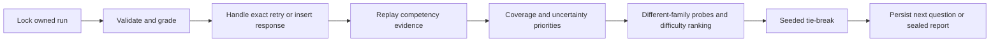

# Hybrid adaptive diagnostic v4.1

Implemented on `codex/hybrid-adaptive-v41` for `/diagnostic-v2`, using the existing private 360-item, eight-competency draft bank. The design, direct question transitions, numeric controls, original lessons and historical attempts are retained. No new questions are generated during an assessment. No production data, migration, merge or deployment is involved.

## Architecture and compatibility

The existing Next.js App Router UI calls the owned diagnostic API. The service already supplies opaque cookie sessions, origin checks, ownership-scoped PostgreSQL locks, immutable bank snapshots/digests, unique response positions, retry idempotency, draft/hint persistence and sealed report JSON. These mechanisms remain in use.



The response, next-question decision and completion report commit in one transaction. Invalid numeric syntax creates no response and does not change evidence. Response payloads retain the selected option or typed representation; item versions are in the immutable bank snapshot. Private selection rationale and `answeredAt` timestamps remain on each response. The current selection is persisted on the run.

Fresh eight-area attempts use engine `hybrid-4.1.0-draft.1`. Existing `hybrid-4.0.0-draft.1`, rules-1, rules-2 and rules-3 attempts retain their previous selector/report dispatch. Completed reports are read, never recomputed. Bank IDs/content versions and original answer keys are unchanged because this is an engine revision. No Prisma migration is necessary.

The immutable run UUID is the random seed. Equal-ranked candidates are ordered by SHA-256 of engine version, seed, position and candidate ID. No additional seed column is required. Refresh returns the persisted question; rebuilding from the same seed and evidence reproduces the choice. The client cannot supply an engine version or selection seed.

The selector returns the existing `Selection` contract. A future calibrated selector can use another engine version and this dispatch boundary; Bayesian IRT and calibrated probabilities are not implemented. Preserve the v4.0 and v4.1 implementations when adding future versions.

## Decision rules

Each competency begins at Intermediate, independently of the other seven. A single unassisted correct/incorrect response holds difficulty. Two consecutive independent correct responses at the requested level can raise difficulty by one; two independent misses at or below it can lower it. Bounds are Beginner–Advanced. Assisted answers reset streaks and hold difficulty. Explicit unsure resets the streak and can request a simpler task. Easier fallback successes cannot automatically promote an unverified higher level.

Coverage takes precedence: the first 24 questions provide three different families in every competency. Within equally covered areas, eligible misconception probes receive priority. After coverage, unresolved evidence and eligible single-observation probes can use up to six additional questions. A focused recovery case finishes at 26; uncertain cases can reach 30. Exhausted families stop with an explicit explanation. Neither item IDs nor families repeat in a run.

Item ranking is lexicographic: eligible different-family probe, distance from requested difficulty, unseen subskill, unseen content/response format, then seeded ordering. Probes may use a neighbouring difficulty. Prerequisites supply report/selection context; they do not transfer credit or silently lower a new competency's starting level. Prior-informed reassessment changes initial routing only and discloses it.

## Misconception evidence

A suspicion starts only from a wrong, unassisted MCQ selection with an authored option label. Missing labels, numeric misses and unsure answers create no invented misconception. Exact labels can match across families. Seven explicit engineering topic bridges also permit related probes for copying/references, arguments/defaults, object state, complexity, cleanup, testing boundaries and file/resource handling.

The bridges group broad difficulties; repeated errors in related tasks do not prove one precise cognitive cause. Original selected labels are retained in the final report so reviewers can distinguish the actual errors. These bridges remain draft and require educator approval.

One supporting family is suspected. Two supporting families with no contrasting probe are a repeated preliminary signal. A subsequent independent correct probe is contrasting evidence; mixed support stays unconfirmed. Assisted or unsure probes cannot confirm or refute the suspicion. Some supplied labels exist only inside one family, and some topic probes lack an MCQ label; those cases may remain unconfirmed rather than repeating parameter variants.

## Report rules

New reports distinguish determinate unassisted answers, unsure responses and assisted answers. The assisted summary excludes unsure so the categories partition submitted responses; individual review still retains whether a hint was used. They show independent matches/misses, family variety, per-difficulty evidence, prerequisite context, targeted subskills, cautious hypotheses and learning priorities. Review marks unsure explicitly and uses a neutral colour. Correct options/accepted answers remain available only in the completed owned review.

Three independent families across at least two subskills are required for a conclusion. Strength requires consistent success with at least two applied-level matches; five independent observations can resolve one earlier miss after repeated success. Repeated independent difficulty supports a likely gap. Otherwise the result is Insufficient evidence, including at the question limit. Successful intermediate answers and unsuccessful advanced probes are described separately rather than hidden behind an aggregate percentage.

These thresholds are initial engineering heuristics. “Independent” means unassisted responses from distinct authored families, not validated statistical independence. Raw correct totals describe the actual attempt and do not establish hiring readiness or permit fair comparisons across different adaptive paths.

## Example sequences

These deterministic fixtures are synthetic response policies, not models validated against real students. Sequences below show **Python Fundamentals only**; coverage questions in other areas occur between them.

| Profile | Fundamentals sequence | Complete run |
| --- | --- | --- |
| Beginner, every answer wrong | Q2 `SS-PY-0019` Intermediate miss → Q11 `SS-PY-0027` Intermediate miss → Q20 `SS-PY-0007` Beginner miss | 26; eight likely gaps, with extra probes |
| Intermediate, succeeds through Intermediate | Q6 `SS-PY-0018` Intermediate match → Q11 `SS-PY-0019` Intermediate match → Q17 `SS-PY-0042` Advanced miss | 30; limited advanced transfer remains uncertain |
| Advanced, all independent answers correct | Q5 `SS-PY-0020` Intermediate match → Q10 `SS-PY-0022` Intermediate match → Q19 `SS-PY-0041` Advanced match | 24; eight preliminary strengths |

The aliasing fixture selects `SS-PY-0061` in family 021, then a different-family copying probe `SS-PY-0064` in family 022. Supporting errors remain traceable to their actual selected labels. Additional profiles cover strong fundamentals/weak DSA (25 questions), repeated copying-related errors (24), all unsure (30) and all assisted (30).

`SELECTION_TRACES.json` records all seven profiles, seeds, item/version/family, difficulty, type, answer, assistance, correctness, private rationale, stop reason and report. `BASELINE_COMPARISON.json` executes the preserved old selector: all-unsure previously ended after 24 with likely gaps; the new engine ends after 30 with insufficient evidence and no inferred misconceptions. This comparison concerns local source behavior, not the live deployment.

## Files changed

| File | Purpose |
| --- | --- |
| `src/lib/diagnostic/hybrid-vnext.ts` | Versioned evidence replay, topic bridges, classifier and selector |
| `src/lib/diagnostic/engine.ts` | Version dispatch, optional explicit unsure route and new-report construction |
| `src/lib/diagnostic/service.ts` | New-run version/seed and historical dispatch inside existing transactions |
| `src/lib/diagnostic/types.ts` | Optional report evidence fields, preserving old shapes |
| `src/components/diagnostic-experience.tsx` | Difficulty evidence, uncertainty and contrasting probes in the existing report |
| `src/components/diagnostic-question-review.tsx` | Explicit unsure counts/results in new reports |
| `src/components/diagnostic.module.css` | Neutral unsure review styling |
| `tests/diagnostic-hybrid-vnext.test.ts` | Profiles, streaks, probes, ties, exhaustion and stopping rules |
| `tests/diagnostic-hybrid-service.test.ts` | Persistence, resume, ownership, idempotency and old-engine preservation |
| `tests/helpers/hybrid-profiles.ts` | Reusable deterministic profile fixtures |
| `e2e/diagnostic-hybrid-vnext.spec.ts` | Browser unsure/resume/report review regression |
| `scripts/audit-hybrid-v41.ts` | Reproducible traces and baseline comparison |

## Local testing and rollback

The running local app uses `http://localhost:3002/diagnostic-v2`. **Start a fresh attempt** to receive v4.1. Resuming an existing attempt intentionally keeps its original engine. Use “Start a new diagnostic (keep this attempt)” if a saved run is shown; older report bookmarks remain valid.

For a future local restart, use the existing disposable PostgreSQL/audit configuration; do not substitute production credentials. With no other verified server using port 3002:

```powershell
$env:DIAGNOSTIC_STARTER_V3_PREVIEW='true'
$env:DIAGNOSTIC_DRAFT_ENV='local'
$env:DIAGNOSTIC_STARTER_V3_DEFAULT='true'
node --env-file=.env.audit node_modules/next/dist/bin/next start --hostname 127.0.0.1 --port 3002
```

Tracked and hosted flags remain disabled. The draft gate requires a loopback DB and rejects VERCEL. New engine startup is limited to that preview. A build uses `VERCEL=1` to skip migration and seed; use a fresh shell without VERCEL when starting the local preview. Stop verified Next processes and finish database tests before Prisma generation on Windows.

```powershell
node --env-file=.env.audit node_modules/vitest/vitest.mjs run
node node_modules/eslint/bin/eslint.js .
node node_modules/typescript/bin/tsc --noEmit
node --import tsx scripts/audit-hybrid-v41.ts
```

Rollback consists of disabling the local draft flags to return to the six-area default. Preserve engine support, imported bank rows and saved runs; do not delete snapshots or downgrade the engine version of an existing attempt. A future public rollout requires explicit approval, educator review and a separate staging release.

## Remaining limitations

- The 360 questions, distractors, topic bridges, difficulty labels and stopping thresholds need independent educator review and low-stakes learner pilots. They remain unapproved.
- Related-family probes may test a broader topic rather than the exact original erroneous belief. Thin metadata or exhausted eligible probes stay explicitly uncertain. Additional reviewed parallel families would improve this.
- Conservative intermediate profiles may remain insufficient after 30. Per-difficulty evidence is retained; no unsupported mastery band is substituted.
- Eight short practice starters exist; they do not supply complete targeted lessons for all 120 families/subskills.
- No IRT, empirical calibration, measured load capacity, full screen-reader audit or cross-engine browser certification. Existing legacy manipulation-state audit findings were not part of this engine change.
- Production deployment/commit parity was not inspected. No production behavior is attributed to this local implementation.

Final commands/results and build provenance are recorded separately after verification. Screenshots in `previews/` contain disposable synthetic QA data.
