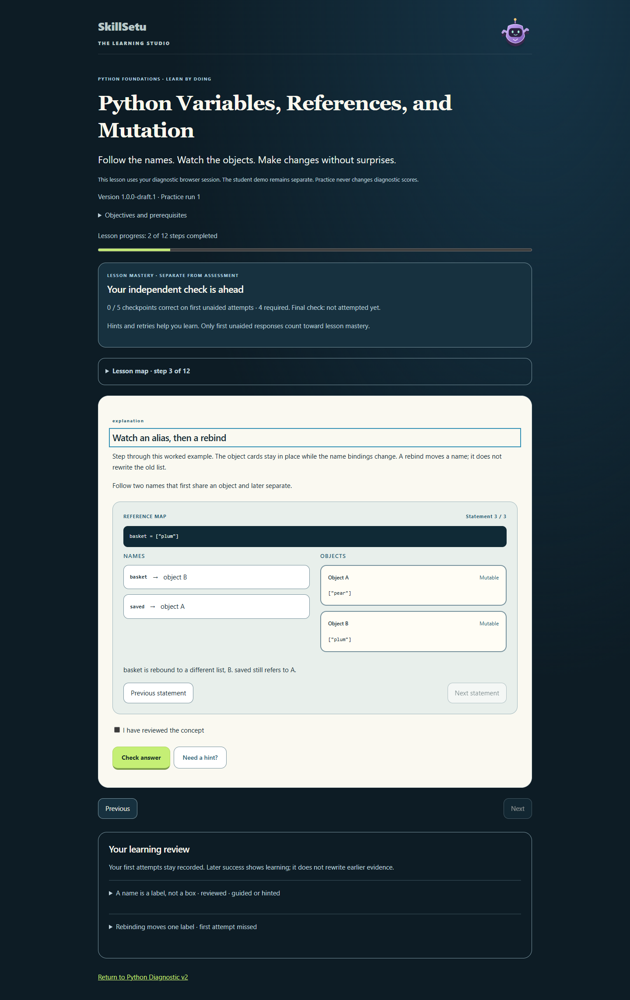
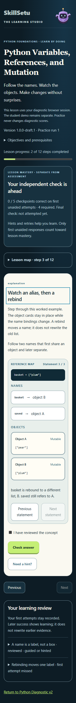
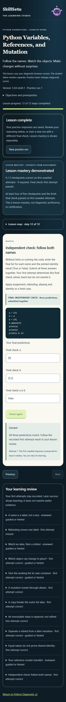

# Python Variables, References, and Mutation — Phase 3

Implemented locally on 3 November 2026, branch `codex/variables-references-lesson`. This is original learning content using the Phase 2 lesson engine, not diagnostic content or a replacement application.

## Open the completed lesson

**http://127.0.0.1:3007/diagnostic-v2/learn/variables**

The compiled application is running on loopback port 3007 with the local-only Learning Studio flag and isolated `skillsetu_studio_dev` database on port 15434. The existing development server on port 3002 was left alone. Both the lesson route, the earlier demonstration route and the lesson API returned HTTP 200 after hosting. No deployed-build parity is claimed.

For subsequent development, `npm run dev:studio` uses ignored `.env.studio` and validates its loopback development database. Stop any other Next development server from this checkout first: Next permits one development lock per checkout. The current handoff uses `next start` instead, so it can coexist with that server.

## Content and behavior

Stable lesson ID `python-variables-references`; content version `1.0.0-draft.1`; schema version 1; evaluator `studio-contracts-2`; mastery policy `lesson-mastery-1`.

| Step ID | Learning interaction |
| --- | --- |
| vr-names | Explanation: names reference objects; introductory reference diagram |
| vr-rebind | Predict the original value after another name is rebound |
| vr-map | Step through alias creation and rebinding with names-to-objects visualization |
| vr-mutable | Reason about mutable lists, immutable strings and nested objects |
| vr-copy-block | Complete code with a shallow copy; contrast aliasing and mutation results |
| vr-alias-output | Predict list mutation through an alias |
| vr-copy-output | Predict an unchanged original list after changing a copy |
| vr-string-output | Predict string rebinding without changing the original reference |
| vr-trace | Enter both final list states after rebinding and mutation |
| vr-identity | Distinguish equal list values from object identity |
| vr-review | Review the reasoning checklist and shallow-copy limitation |
| vr-final | Independent, three-part reference-state check |

The reusable UI provides next/previous navigation, a collapsible lesson map, progress, hints where authored, immediate learning feedback, retries, readable first/latest answer review, autosaved drafts and reference-frame position, refresh/resume, and new practice runs. It reuses the original Orbit companion and application tokens. Keyboard controls, focus movement, live status, small-screen layout and reduced-motion behavior are included.

The output evaluator parses bounded Python literals without executing expressions. Formatting and quote equivalents are accepted; semantic differences, arbitrary expressions and calls are rejected. Plain string-output whitespace remains significant. Numeric and Python-literal fields have separate input modes and instructions.

## Completion and mastery are separate

Progress can reach 12/12 through learning retries. Mastery additionally requires at least **four of five first-attempt, unaided checkpoints**, plus a fully correct **first-attempt, unaided final check**. Hinted or retried success does not replace first-attempt evidence. Final checks have no hint or execution control.

The first three practice runs use three different authored final forms, deterministically selected from the immutable run ordinal and pinned content. After those forms are exhausted, practice remains available but reused forms cannot award fresh independent mastery. This is a conservative lesson milestone, not assessment proficiency, certification or validated psychometrics. Further independent forms and educator review remain future content work.

## Persistence and historical protection

No Phase 3 schema migration is needed. The lesson uses the existing Phase 2 LearningPlan/LearningModule/LearningRun/step-response persistence, immutable module snapshots, owned diagnostic prototype session, idempotency and draft revisions. Unknown lesson IDs and prototype-property names are rejected. Legacy demo sessions are not linked or credited.

The new evaluator is versioned; the earlier demonstration's serialized authored content, evaluator and completion policy remain unchanged. Assessment scoring and practice mastery stay separate. A synthetic completed diagnostic's report and response records were compared before and after learning. Archived lesson runs were also checked after a new practice run.

A phase-start hash comparison verified **34 protected assessment/bank/service/schema/migration files unchanged**. No published bank, assessment key, applied migration or learner history was edited. Prior uncommitted security and Phase 2 work was preserved. No production database, push, PR, merge or deployment was performed.

## Verification

Tests used a newly created disposable **skillsetu_variables_test** database on the dedicated loopback PostgreSQL cluster at port **15434**. Both DATABASE_URL and TEST_DATABASE_URL were explicitly set to that test store. Existing checked-in migrations and synthetic seed data were applied only there; production/shared databases and the existing application databases on port 15432 were not used.

| Check | Result |
| --- | --- |
| Full Vitest unit/integration suite | PASS: 215/215, 23 files, 74.82 seconds |
| Final affected lesson unit/integration rerun | PASS: 21/21, four files, 12.97 seconds |
| TypeScript and ESLint | PASS after final source changes |
| Initial full npm production build | PASS |
| Final guarded production compilation | PASS; build ID `t1YFKhPCzsMLRNmkvpJ9f` |
| Existing Chromium journeys | PASS: 14/14, 2.1 minutes |
| Final Phase 2 + Phase 3 Chromium journeys | PASS: 6/6, 46.6 seconds |
| Desktop, 390px and 320px | PASS: complete new lesson at all three widths; no horizontal overflow |
| Refresh/resume and saved reference state | PASS |
| Wrong answer, hint/retry, progression and mastery | PASS |
| New run with different final form; archived review | PASS |
| Ownership, private keys, identity separation, historical report | PASS in service/API regressions |
| Visible JavaScript errors in new lesson journeys | None observed |
| Existing five-page A4 report PDF | Rendered and visually inspected; no clipping observed |

The final 21-test rerun covers the last changes to review ordering, own-property lesson lookup and heading focus; the full 215-test run preceded these small changes. The 20 browser cases are distinct cases, not a sum of repeated attempts. An initial mobile test read the old run ordinal before the asynchronous new-run request finished; waiting for the new-run UI resolved the harness race, and all final journeys passed.

Windows limitation: repeating `npm run build` encountered Prisma's native DLL rename EPERM while another local development server held the existing client. That server was not killed. With the unchanged generated client, `VERCEL=1 node --import tsx prisma/build-setup.ts` followed by `node node_modules/next/dist/bin/next build` passed; the setup guard skipped database writes. There was no schema change requiring regeneration. A clean full build should be repeated with other local servers stopped before release.

Accessibility checks cover native keyboard interaction, labels/status/focus, reduced motion, responsive rendering and visible overflow. They do not constitute an exhaustive assistive-technology audit. No load/capacity claim is made. Independent educator review of this draft lesson and production rollout remain pending; hosted flags remain off. Earlier optional/development dependency audit concerns are recorded separately in `../security-dependency-review/README.md` and were not reclassified by this task.

## Review screenshots

## Relevant files and tests

Content: `src/lib/learning-studio/variables-lesson.ts`. Versioned selection: `catalog.ts`. Safe output contract: `output-contract.ts`. First-attempt practice milestone: `mastery.ts`. Human-readable review: `review.ts`. Visualization: `src/components/reference-visual.tsx`. Shared runner/service/API remain in the Phase 2 locations.

New regressions: `tests/variables-lesson.test.ts`, `tests/variables-lesson-service.test.ts`, `e2e/variables-lesson.spec.ts`. Preserved demonstration regressions: `tests/learning-studio*.test.ts`, `e2e/learning-studio.spec.ts`.

To try the vertical slice, open the route, start the lesson, deliberately miss one prediction, retry it, advance the reference visualization, refresh, complete the remaining steps and final check, inspect first/latest responses, then choose a new practice run. The second run must begin at zero progress with a different final form; the prior run remains preserved.
